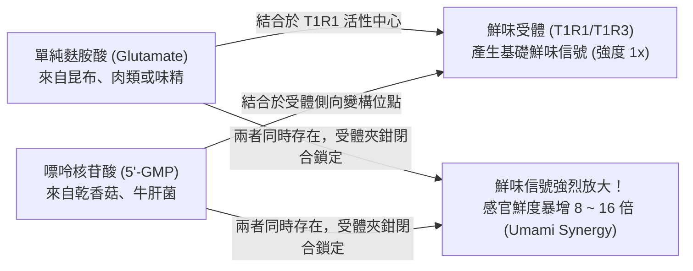
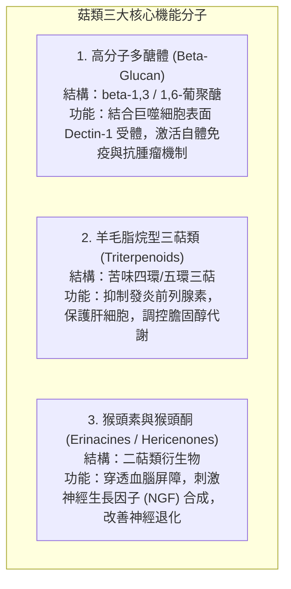

# 食藥用菇菌的科學解析：多醣體、三萜類與鮮味（Umami）協同分子效應 (Edible & Medicinal Mushrooms & Umami Science)

> 💡 **核心速覽**：為什麼香菇雞湯或日式高湯（昆布+乾香菇）會鮮美到讓人舌頭發麻？這不是錯覺，而是**「鮮味相乘效應 (Umami Synergy)」**——香菇中的「鳥苷酸」與昆布中的「麩胺酸」同時嵌入舌頭味覺受體時，鮮味強度會暴增 **8 倍以上**！此外，菇類的多醣體與三萜類更是現代機能食品的重要支柱。

---

## 1. 廚房中的鮮味之王：乾香菇泡發的分子奧秘

許多料理愛好者都知道，新鮮香菇嚐起來鮮味平平，但一旦乾燥再泡發，鮮味與香氣會猛烈爆發。傳統廚房常有人用「滾燙熱水」快速泡開香菇，這在食品化學上卻是個大忌！

為什麼？
- 新鮮香菇細胞中含有豐富的核糖核酸 (RNA) 與自體水解酵素。在乾製脫水與後續泡水過程中，**核酸內切酶 (Phosphodiesterase)** 會被激活，將香菇中的 RNA 剪切分解為天然增鮮核苷酸——**鳥苷酸 (Guanosine 5'-monophosphate, 5'-GMP)**[^1]。
- **實作關鍵溫度**：若直接用 100°C 滾水沖泡，高溫會瞬間破壞酵素活性，使其來不及催化合成鳥苷酸；最佳泡發溫度為 **冷水（4°C 冷藏慢泡數小時）或 50°C 溫水**，方能激發最大鮮味分子[^1]。

---

## 2. 微觀生化機制：鮮味受體的「立體夾鉗」相乘效應

人類的第五種基本味覺——**鮮味 (Umami)**，是由舌頭味蕾上的 heterodimer G 蛋白偶聯受體 **T1R1 + T1R3** 所感應[^1]：

- **單一刺激**：單獨吃一匙味精（L-麩酸鈉）或單喝香菇水，鮮味只是溫和線性上升。
- **協同放大 (Synergy)**：當 5'-GMP 結合在受體的立體變構區域時，會促使受體結構如同「夾子」般迅速閉合，將麩胺酸牢牢鎖在活性中心，解離速度大幅減緩。大腦接收到的神經電訊號呈幾何級數放大，鮮度直接跳躍 **8 至 16 倍**！這正是「昆布香菇高湯」與「香菇燉雞湯」鮮美無比的底層化學本質。

---

## 3. 藥用菇核心活性物質與生化機轉

除了廚房餐桌上的鮮味，多孔菌與擔子菌綱的藥用菇類（如靈芝、牛樟芝、猴頭菇、冬蟲夏草）富含獨特的次級代謝產物[^1]：

### (1) $\beta$-葡聚醣 ($\beta$-Glucan)
- 主要存在於菇類的細胞壁中（如香菇多醣 Lentinan、雲芝多醣 Krestin）。
- **機轉**：人類缺乏消化 $\beta$-1,3 鍵結的酵素，多醣體抵達小腸後，其特殊的立體構型能精準契合腸道派氏集合淋巴結 (Peyer's patches) 巨噬細胞與樹突細胞上的 **Dectin-1 受體**，誘發細胞釋放介白素 (IL-12) 與干擾素 ($\text{IFN}-\gamma$)，全面喚醒人體自然殺手細胞 (NK cells) 的巡邏吞噬能力[^1]。

### (2) 三萜類化合物 (Triterpenoids)
- 靈芝酸 (Ganoderic acids) 與牛樟芝特有的樟芝酸 (Antcins)。
- **機轉**：具備強烈苦味，能抑制脂多醣 (LPS) 誘發的微膠細胞與肝臟發炎路徑，下調 iNOS 與 COX-2 表現，發揮護肝與清除自由基之功效[^1]。

---

## 4. 消費者與料理者的關鍵辨識：子實體 vs. 菌絲體

市售靈芝與冬蟲夏草產品價格差距高達數十倍，關鍵在於**生長階段與來源部位**[^1]：

| 評估維度 | 菇類子實體 (Fruiting Body) | 菇菌菌絲體 (Mycelium) |
| :--- | :--- | :--- |
| **定義與生長** | 長出地表、具備蕈傘/蕈柄的完整成熟菇體（需數月至數年生長） | 液體深層發酵槽中快速繁殖的白色絲狀細胞團（幾天至數週即可收成） |
| **有效成分密度** | **三萜類含量極高**、多醣體分子量大且結構複雜完整 | 多醣體通常混合了發酵液殘留的澱粉或培養基；**三萜類極低甚至未檢出** |
| **法規與標示要求** | 可直接標示為「靈芝」或「冬蟲夏草子實體」 | 台灣法規嚴格規定：**不得直接宣稱「冬蟲夏草」**，必須標示為「冬蟲夏草菌絲體」，且字體大小須完全一致，需出具菌種證明供查驗[^1]。 |

---

## 5. 相關概念與延伸閱讀
- 食品安全重大中毒案件：`[致命的廚房隱形殺手：邦克列酸的中毒機制](../myths-safety/bongkrekic-acid-and-fermented-food-safety.md)`
- 機能成分提取與微膠囊化：`[機能性食品成分與生化機制](functional-food-ingredients.md)`
- 食品法規分級：`[食品、健康食品與特殊營養食品的分級界定](../myths-safety/food-classifications-and-health-food.md)`
- 質地設計與長者餐飲：`[食物質地設計與高齡友善飲食](../techniques/food-texture-modification-and-iddsi.md)`

---

## 6. 參考資料與延伸閱讀
1. 謝松源. 《生物資源庫與食藥用菇類產品：菇蕈生物學、活性成分與多樣化市場開發》. 國立清華大學生命科學暨醫學院 / 財團法人食品工業發展研究所生物資源保存及研究中心 (BCRC). 2026-10-15. 投影片 60-70, 115-152.
2. Kurihara, K. "Umami the Fifth Basic Taste: History of Studies on Receptor Mechanisms and Role as a Food Flavor." *BioMed Research International*, 2015, 189402.
3. Wasser, S. P. "Medicinal Mushrooms as a Source of Antitumor and Immunomodulating Polysaccharides." *Applied Microbiology and Biotechnology*, 2002, 60(3), 258-274.
4. 衛生福利部食品藥物管理署 (TFDA). 〈冬蟲夏草菌絲體食品標示規定〉. 衛署食字第 1011300898 號公告.
