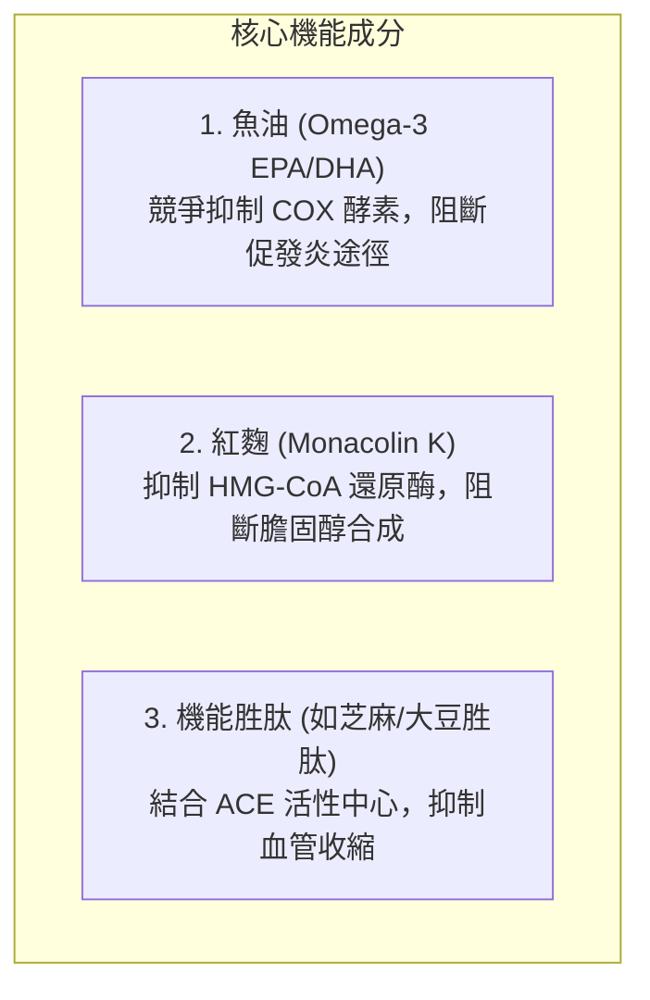
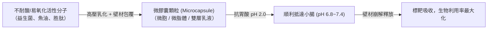

# 機能性食品成分與生化機制：魚油、紅麴、降壓胜肽與微膠囊包埋技術 (Functional Food Ingredients & Mechanisms)

> 💡 **核心速覽**：吃進肚子裡的保健成分如何發揮作用？魚油是透過抑制發炎前列腺素來護心，紅麴中的 Monacolin K 結構竟與降血脂西藥完全相同！然而，高活性成分往往伴隨著光熱敏感氧化與發酵毒素風險，需要現代「微膠囊包埋技術」與嚴格法定規格把關。

---

## 1. 什麼是「機能性食品成分 (Bioactive Food Components)」？

依據國際食品科技學會 (IFT) 與日本特定保健用食品 (FOSHU) 的科學定義：**機能性食品成分**是指除了提供日常基礎巨量營養（碳水化合物、蛋白質、脂肪）之外，經科學實證能對人體生理節律、抗氧化防禦或特定代謝途徑發揮有益調節作用的活性分子[^1]。

在台灣衛福部（TFDA）公告的「第二軌規格標準審查」中，目前僅有 **「魚油」** 與 **「紅麴」** 兩項成分因具備世界公認的確切科學實證、明確功效機轉與長期安全食用史，被核准為標準化規格健康食品[^1]。

---

## 2. 核心機能成分之微觀生化機制

### (1) 魚油（$\omega$-3 多不飽和脂肪酸：EPA 與 DHA）
- **主要活性成分**：二十碳五烯酸 (Eicosapentaenoic acid, EPA) 與 二十二碳六烯酸 (Docosahexaenoic acid, DHA)。
- **生化調節機制**：
  1. **抗發炎與心血管保護**：EPA 與細胞膜上的花生四烯酸 (Arachidonic acid, AA) 競爭環氧化酶 (COX-2) 與脂氧化酶 (LOX)。AA 代謝會產生強烈促發炎的第 2 系列前列腺素 ($PGE_2$) 與第 4 系列白三烯素 ($LTB_4$)；而 EPA 代謝產生的則是抗發炎或弱發炎的 $PGE_3$ 與消退素 (Resolvins)，顯著降低血管內皮發炎反應。
  2. **調節血脂**：抑制肝臟內三酸甘油酯合成限速酵素，並促進脂肪酸 $\beta$-氧化，降低血液中極低密度脂蛋白 (VLDL) 與三酸甘油酯。
- **法定規格與安全標準**：
  - 台灣第二軌標準規範：$\omega$-3 脂肪酸純度應為 **30% 至 50%**，每日攝取量以 EPA+DHA 計應達 **1.0 克至 2.0 克**[^1]。
  - **保存與料理禁忌**：EPA/DHA 含有多達 5~6 個不飽和雙鍵，極易發生**脂質過氧化 (Lipid peroxidation)**，產生過氧化自由基與哈味醛類。魚油膠囊切忌高溫日曬，烹調高脂魚類（鮭魚、鯖魚）建議以低溫清蒸或中火慢煎，避免油炸烈火破壞油脂結構。

### (2) 紅麴（*Monascus purpureus* 發酵代謝物）
- **主要活性成分**：**Monacolin K**（化學結構與臨床第一代降血脂處方藥 **Lovastatin** 完全一模一樣！）[^1]。
- **生化調節機制**：
  - 肝臟合成內生性膽固醇時，關鍵限速酵素為 **HMG-CoA 還原酶**。Monacolin K 具有與 HMG-CoA 極為相似的結構，能與其受體產生競爭性結合，阻斷內生性膽固醇合成途徑，進而促使肝細胞增加表面低密度脂蛋白受體 (LDL Receptor)，加速清除血液中的壞膽固醇 (LDL-C)。
- **關鍵食安風險與法規管制**：
  - **橘黴素 (Citrinin) 污染**：紅麴菌在特定發酵溫濕度條件下，易伴隨產生具腎臟與肝臟毒性的真菌毒素「橘黴素」。台灣法規嚴格規定紅麴原料與產品中橘黴素含量必須 **< 2 ppm (2 mg/kg)**[^1]。
  - **食用禁忌與交互作用**：正服用降血脂藥物（Statin 類）者**嚴禁同時食用紅麴保健品**，否則血中藥物濃度過高會大幅增加**橫紋肌溶解症 (Rhabdomyolysis)** 與急性腎衰竭風險。

### (3) 機能胜肽（酵素水解短肽）
- **代表案例**：芝麻胜肽 (Sesame peptides)、大豆胜肽、苦瓜胜肽。
- **生化調節機制**：
  - 食品所研發之芝麻胜肽由芝麻榨油後的殘粕蛋白經專一性蛋白酶水解而得。特定短肽序列（如 2~4 個胺基酸）能精準嵌入**血管張力素轉化酶 (Angiotensin-Converting Enzyme, ACE)** 的活性催化凹槽，阻止血管張力素 I 轉化為強效縮血管的血管張力素 II，進而放鬆血管周邊阻力、輔助調節血壓（其體外抑制活性指標 $IC_{50}$ 可達 7.6 mg/mL，媲美日本同類生技產品）[^1]。

---

## 3. 製程科學：微膠囊化與新穎萃取技術

活性成分若無法安然通過胃酸膽鹽考驗，吃進去也只是穿腸而過。食品工業採用高階物理技術解決安定性難題：

1. **微膠囊化技術 (Microencapsulation)**：
   - 利用天然高分子多醣（麥芽糊精、阿拉伯膠、海藻酸鈉）或蛋白質（明膠、大豆分離蛋白）作為「壁材」，以噴霧乾燥法 (Spray drying) 或液滴凝聚法將易氧化的魚油或脆弱的乳酸菌包覆於微米級（1~100 $\mu m$）微球內。
   - **功效**：隔絕氧氣防止魚油酸敗，並具備「耐胃酸、腸道崩解」的腸溶特性。
2. **酵素性酯化技術 (Enzymatic Interesterification)**：
   - 傳統天然魚油中 $\omega$-3 多以三酸甘油酯 (TG) 形式存在，但濃度僅約 30%。
   - 食品所運用酵素轉酯化技術，能在常溫低溫下將 EPA/DHA 濃度富集純化至 **80%~90%**，同時重構為人體小腸最易吸收的 95% 三酸甘油酯 (rTG) 結構，大幅提升生物利用率[^1]。

---

## 4. 多方觀點與安全食用評估

針對機能食品成分，醫學界與食品科學界的客觀觀點並陳：

| 評估面向 | 飲食天然攝取觀點（全食物 Whole Food） | 濃縮機能補充品觀點（Dietary Supplement） |
| :--- | :--- | :--- |
| **代表模式** | 每週食用 2~3 次深海魚（鮭魚/鯖魚）、發酵紅麴料理、豆漿豆腐 | 每日吞服高濃度魚油膠囊、紅麴萃取膠囊、大豆異黃酮錠 |
| **協同效應與吸收率** | 食物中同時含有優質蛋白質、硒、維生素 D 及天然抗氧化磷脂質，形成天然抗氧化保護矩陣，不易氧化。 | 有效成分濃度高、劑量精確標準化，適合飲食受限或特定缺乏者快速補充。 |
| **潛在過量風險** | 極低（正常飲食幾乎不可能導致 Monacolin K 或脂溶性成分中毒）。 | 較高（若誤以為「天然無害」而加倍服用，可能造成凝血時間延長、肝酵素指數上升）。 |

---

## 5. 相關概念與延伸閱讀
- 法規分級與小綠人標章：`[食品、健康食品與特殊營養食品的分級界定](../myths-safety/food-classifications-and-health-food.md)`
- 食品安全防禦矩陣：`[食品防護與現代食安觀](../myths-safety/food-protection-and-safety-paradigm.md)`
- 新穎蛋白素材：`[替代性蛋白質與植物肉的科學解析](alternative-proteins-and-plant-meat.md)`
- 基因編輯功能性作物：`[基因改造 vs 基因編輯食品](gmo-vs-gene-edited-foods.md)`

---

## 6. 參考資料與延伸閱讀
1. 董志宏. 《健康食品與保健營養食品：機能食品開發與研發案例》. 國立清華大學生命科學暨醫學院 / 財團法人食品工業發展研究所產品製程研發中心. 2026-10-01. 投影片 2-16, 28-29, 157-161.
2. 衛生福利部食品藥物管理署 (TFDA). 〈健康食品規格標準：魚油、紅麴〉. 衛部健食規字號管理規範.
3. Calder, P. C. "Mechanisms of Action of (n-3) Fatty Acids." *The Journal of Nutrition*, 2012, 142(3), 592S-599S.
4. Endo, A. "A Historical Perspective on the Discovery of Statins." *Proceedings of the Japan Academy, Series B*, 2010, 86(5), 484-493.
