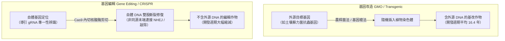

# 基因改造 vs 基因編輯食品：從 CRISPR 分子剪刀到抗褐變蘋果與高 GABA 番茄 (GMO vs. Gene-Edited Foods)

> 💡 **核心速覽**：傳統「基因改造 (GMO)」就像把外來程式碼整段貼進生物體；而「基因編輯 (Gene editing)」則像用精密的「分子剪刀」在生物自帶的 DNA 字典中修飾拼錯的單字，成品**不含任何外源基因**，大幅縮短了作物的育種時程。

---

## 1. 廚房中的生活現象：切開的蘋果為什麼不會變黑？

許多人有過切蘋果或削馬鈴薯的經驗：只要暴露在空氣中十幾分鐘，表面就會逐漸發黃、轉褐，失去賣相與爽脆口感。

傳統廚房的解決方法是**泡鹽水**或**滴檸檬汁**；但在現代農業生技中，科學家已經成功培育出「切開數天也完全不會變褐」的**北極蘋果 (Arctic Apple)** 與抗褐變蘑菇。這是怎麼做到的？我們吃進肚子裡的到底是不是「基改食物」？

---

## 2. 微觀科學機制：基因改造 vs. 基因編輯

大眾常將「基因改造」與「基因編輯」混為一談，但兩者在分子生物學的本質與工具上有著巨大分野[^1]：

### (1) 基因改造 (Genetically Modified Organism, GMO)
- **原理**：利用**農桿菌感染法 (Agrobacterium-mediated transfer)** 或**基因槍法 (Gene gun)**，將其他物種的外源基因（Exogenous DNA）隨機轉殖嵌入植物細胞的染色體中。
- **代表性作物**：
  - **抗蟲玉米/棉花 (Bt crops)**：轉殖蘇力菌（*Bacillus thuringiensis*）的伴孢晶體蛋白基因，害蟲食用後腸道穿孔死亡，人類腸道為酸性且缺乏專一受體不受影響。
  - **耐除草劑大豆 (Roundup Ready Soy)**：轉殖耐嘉磷塞 (Glyphosate) 酵素基因，便於大面積除草。
  - **粉紅鳳梨 (Pinkglow / Rosé Pineapple)**：轉殖基因抑制茄紅素轉化為 $\beta$-胡蘿蔔素的酵素，同時干擾乙烯生成，使果肉富含番茄紅素而呈粉紅色且延緩過熟[^1]。

### (2) 基因編輯 (Gene Editing / CRISPR-Cas9)
- **原理**：2020 年獲頒諾貝爾化學獎的 **CRISPR-Cas9** 技術，源自細菌防禦病毒感染的古老免疫系統。由一條導引 RNA (gRNA) 精確導航至宿主自體基因組的特定鹼基序列，引導 Cas9 內切核酸酶將 DNA 雙股精確剪斷。
- **無外源基因特性**：細胞啟動自體修復機制（非同源末端連接 NHEJ），在修復過程中隨機發生微小的鹼基缺失或插入（InDels），使目標基因失去功能（**基因敲除 Gene Knockout**），或進行單鹼基置換。**其遺傳特徵與自然界自發性突變完全無法區分，且不含任何外來物種基因**[^1]。

---

## 3. 餐桌上的基因編輯指標案例

基因編輯已從實驗室走向實體餐飲市場，帶來許多革命性的廚房食材：

### 案例 1：日本高 GABA  Sicilian Rouge 番茄（全球首款商業上市基因編輯番茄）
- **科學機制**：番茄天生會合成 $\gamma$-胺基丁酸 (GABA，一種能放鬆神經、輔助調節血壓的神經傳導物質)，但自體帶有自體抑制結構域 (Autoinhibitory domain)，限制了 GABA 的大量積累。
- **編輯手法**：日本 Sanatech Seed 團隊利用 CRISPR-Cas9 切除該自體抑制區段，使麩胺酸脫羧酶 (GAD) 活性持續開放，番茄中的 **GABA 含量提升 4 至 5 倍**，一顆即可滿足每日調節血壓建議量[^1]。

### 案例 2：抗褐變北極蘋果 (Arctic Apple) 與防黑蘑菇
- **褐變機制**：當蔬果細胞破裂時，細胞質內的**多酚氧化酶 (Polyphenol oxidase, PPO)** 接觸到氧氣與液泡中的酚類受質，氧化生成鄰醌 (o-Quinone)，進而聚合為黑色素沉澱。
- **編輯手法**：利用基因編輯將多酚氧化酶 (PPO) 基因群敲除或靜默，使蘋果切塊後接觸空氣數天仍維持雪白，大幅降低全球食物浪費與褐變丟棄率[^1]。

### 案例 3：低丙烯醯胺油炸馬鈴薯 (Innate Potato)
- **食安威脅**：馬鈴薯在高溫油炸（超過 120°C）時，遊離的**天門冬醯胺 (Asparagine)** 會與還原糖（葡萄糖/果糖）發生梅納反應，副產物會生成世界衛生組織列為 2A 類可能致癌物的**丙烯醯胺 (Acrylamide)**。
- **編輯手法**：敲除天門冬醯胺合成酶 (Asn1) 基因與液泡轉化酶基因，油炸後產生的丙烯醯胺濃度**劇降 70%~90%**，大幅提升薯條與洋芋片的食品安全[^1]。

---

## 4. 實驗條件與多方觀點比對：各國法規與安全爭議

各國對於基因編輯食品是否應比照基改管制，存在顯著的分歧：

| 評估面向 | 美國 (US FDA / USDA) | 日本 (厚生勞動省 / 消費者廳) | 歐盟 (EU / EFSA) | 台灣現行態度 (TFDA) |
| :--- | :--- | :--- | :--- | :--- |
| **法律屬性認定** | 若**不含外源基因 (SDN-1 型)**，視同傳統育種產物，不以基改食品列管。 | 經諮詢評估確認無外源基因者，不視為基改，僅需向政府事前登錄備案。 | 過去（2018年）歐洲法院判決視為 GMO；但近年提出修法草案，擬將符合條件的 NGT（新基因技術）鬆綁。 | 基因改造食品嚴格管理與標示。針對基因編輯食品，衛福部正積極研訂管理指引與跨部會規範[^1]。 |
| **包裝強制標示** | 免強制標示「Bioengineered」（業者可自願標示）。 | 免強制標示，但鼓勵業者標榜「CRISPR 研發」進行消費者溝通。 | 原則上嚴格標示與溯源追蹤。 | 凡含基改原料超過 3% 需強制標示「基因改造」；編輯食品法規討論中。 |
| **科學爭議焦點** | **脫靶效應 (Off-target effect)**：Cas9 核酸酶是否可能在非目標序列誤剪，造成未預期突變？因此全基因體定序 (WGS) 驗證至關重要[^1]。 | **檢測鑑定困難**：編輯產生的點突變與自然突變無異，現有 PCR 檢測法極難在海關抽檢時進行鑑別。 | 尊重消費者知情權與自然生態預防原則。 | 著重於食品毒理、致敏性評估及消費者透明溝通。 |

---

## 5. 相關概念與延伸閱讀
- 添加物與少加工趨勢：`[潔淨標示（Clean Label）與「無添加」的科學真相](../myths-safety/clean-label-science.md)`
- 食品安全法規：`[食品防護與現代食安觀](../myths-safety/food-protection-and-safety-paradigm.md)`
- 新世代蛋白質：`[替代性蛋白質與植物肉的科學解析](alternative-proteins-and-plant-meat.md)`
- 褐變機制：`[梅納反應：高溫香煎與烘焙褐變的分子化學](../mechanisms/maillard-reaction.md)`（待建立）

---

## 6. 參考資料與延伸閱讀
1. 林奐妤. 《基因編輯與基因改造食品》. 國立清華大學生命科學暨醫學院 / 財團法人食品工業發展研究所. 2026-09-24. 投影片 8-22, 120-127.
2. Doudna, J. A., & Charpentier, E. "The New Frontier of Genome Engineering with CRISPR-Cas9." *Science*, 2014, 346(6213), 1258096.
3. Wang, J. Y., & Doudna, J. A. "CRISPR Technology: A Decade of Genome Editing." *Cell*, 2023, 186(4), 496-514.
4. ISAAA. *Global Status of Commercialized Biotech/GM Crops in 2019*. ISAAA Brief No. 55.
