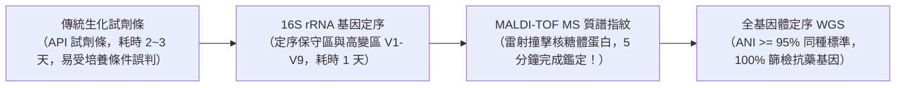

# 益生菌的「身分證」：菌株特異性（Strain Specificity）、質譜快速鑑定與安全性評估 (Probiotics & Strain Specificity)

> 💡 **核心速覽**：買益生菌時，只看「含有嗜酸乳桿菌（A菌）」或「比菲德氏菌（B菌）」就像找員工只看「他是人類」一樣不可靠！現代微生物學強調**「菌株特異性 (Strain specificity)」**——唯有精確標明專利**菌株代碼（如 LGG、BB-12）**的益生菌，其科學功效與安全性才有保證。

---

## 1. 生活迷思：只要是「乳酸菌」，吃進肚子就一定有好處嗎？

許多消費者挑選優格、優酪乳或益生菌粉末時，常看見包裝寫著滿滿的學名：*Lactobacillus acidophilus*、*Bifidobacterium animalis*。大眾常見的誤解包括：

- **迷思一**：「所有同一種乳酸菌，功效都差不多？」
  - ❌ **真相**：即使同屬「鼠李糖乳酪桿菌 (*Lacticaseibacillus rhamnosus*)」，有的菌株（如 LGG）經臨床證實能調節過敏與縮短腹瀉病程；但路邊泥土或一般發酵槽分離出的同名菌株，可能完全沒有定殖能力，甚至帶有抗藥性基因！
- **迷思二**：「益生菌都是好菌，吃越多越安全？」
  - ❌ **真相**：若菌株未經全基因體定序檢驗，可能帶有能轉移給致病菌的「抗生素抗藥性質體」，或在體內代謝產生引發酸中毒的 **D-乳酸** 或引發過敏休克的 **生物胺 (Biogenic amines)**[^1]。

---

## 2. 微觀科學機制：從分類階層到「菌株特異性」

微生物的分類階層遵循林奈雙名法，益生菌的功效**必須精確落實到最後一層的「菌株（Strain）」**[^1]：

```text
界 (Kingdom)    -> 細菌界 (Bacteria)
  門 (Phylum)     -> 厚壁菌門 (Firmicutes)
    綱 (Class)      -> 桿菌綱 (Bacilli)
      目 (Order)      -> 乳酸桿菌目 (Lactobacillales)
        科 (Family)     -> 乳酸桿菌科 (Lactobacillaceae)
          屬 (Genus)      -> 乳酪桿菌屬 (Lacticaseibacillus)
            種 (Species)    -> 鼠李糖乳酪桿菌 (rhamnosus)
              ★ 菌株 (Strain) -> GG 株 (LGG)  <── 唯有這行才是真正的身分證！
```

### 為什麼「菌株特異性」如此關鍵？
1. **表面黏附蛋白結構不同**：菌株細胞壁表面的纖毛 (Pili)、S-層蛋白 (S-layer proteins) 與胞外多醣 (EPS) 構型由特定基因決定。只有特定菌株能耐受膽鹽胃酸並牢牢「吸附」於腸道上皮微絨毛，其他菌株則可能在數小時內被腸蠕動排出體外。
2. **免疫調節訊息分子專一性**：不同菌株分泌的細菌素 (Bacteriocins)、短鏈脂肪酸 (SCFA) 或刺激宿主免疫細胞 Toll 樣受體 (TLR) 的構型截然不同。

---

## 3. 細菌如何驗明正身？現代鑑定技術演進

在食品工業發展研究所生物資源保存及研究中心 (BCRC)，細菌鑑定已從耗時數天的傳統生化培養，跨入高精準質譜與分子生物學時代[^1]：



1. **MALDI-TOF 質譜儀（基質輔助雷射脫附游離飛行時間質譜儀）**：
   - **原理**：挑取單一菌落塗抹於金屬靶盤，加入有機基質，以紫外雷射轟擊。細菌細胞壁破裂，大量高度豐沛的**核糖體結構蛋白 (Ribosomal proteins)** 脫附帶電游離，在真空電場管中飛行。
   - **優勢**：質量小的蛋白質飛得快、質量大的飛得慢。檢測器在短短 **數分鐘內** 記錄下數百個特徵蛋白質峰值，繪出專屬的「質譜指紋圖譜 (Mass spectrum fingerprint)」，與雲端菌種資料庫比對即可秒速定名[^1]。
2. **全基因體定序 (Whole Genome Sequencing, WGS)**：
   - 現代國際益生菌最高規格黃金標準。計算平均核苷酸一致性 (Average Nucleotide Identity, ANI)，**$\text{ANI} \ge 95\%$** 作為界定同種的新標準，並能全面掃描染色體與質體上是否存在潛在有害基因[^1]。

---

## 4. 益生菌安全性評估四大指標

依據世界衛生組織 (WHO)、聯合國糧農組織 (FAO) 及台灣衛福部規定，合格益生菌必須通過以下嚴格安全性測試[^1]：

| 評估項目 | 檢測目的與生化機制 | 風險標準（合格門檻） |
| :--- | :--- | :--- |
| **1. 抗生素抗藥性轉移性** | 測試菌株對常用抗生素（萬古黴素、四環黴素等）的最低抑菌濃度 (MIC)。區分是「內生性內在抗藥」還是「可移動質體抗藥」。 | **絕對嚴禁攜帶可轉移之抗藥基因**！避免在腸道中將抗藥性質體水平轉移 (Horizontal gene transfer) 給致病性金黃色葡萄球菌或沙門氏菌。 |
| **2. 溶血性試驗 (Hemolysis)** | 將菌株接種於綿羊血液瓊脂培養基上，觀察是否會裂解紅血球。 | 必須呈 **$\gamma$-溶血（無溶血反應）**。若出現 $\beta$-溶血（透明溶血圈）代表具致病毒素，一律淘汰。 |
| **3. D-乳酸生成代謝評估** | 人體代謝 L-乳酸速度快，但代謝 D-乳酸酵素活性低。嬰幼兒或短腸綜合症患者若攝入過多產生 D-乳酸之菌株，可能引發代謝性酸中毒。 | 嬰幼兒專用益生菌必須優先選用只產 L-乳酸或 D-乳酸產量極微之菌株。 |
| **4. 生物胺生成性 (Biogenic Amines)** | 某些乳酸菌具有胺基酸脫羧酶，能將組胺酸、酪胺酸轉化為組織胺 (Histamine) 或酪胺 (Tyramine)。 | 攝入過量會引發血管劇烈收縮、頭痛、過敏潮紅甚至心悸，合格益生菌必須為**非生物胺產生菌**。 |

---

## 5. 消費者聰明挑選與食用指南

1. **必看菌株編號**：包裝成分表上，好的產品會清楚列出代碼，例如：*Lactobacillus rhamnosus* **LGG**、*Bifidobacterium lactis* **BB-12** 或本土專利菌株 *L. paracasei* **GMNL-32**。若只寫菌種拉丁學名而無菌株碼，功效大打折扣。
2. **活菌數量 (CFU) 標示**：注意是「出廠保證菌數」還是「保存期限末保證菌數」。益生菌隨時間與室溫會自然衰減，日常建議置於冷藏保存。
3. **與抗生素錯開服用**：服用抗生素藥物時，抗生素會無差別撲殺腸道好壞菌。若需補充益生菌，務必**間隔至少 2 小時以上**，以保全活菌存活率。

---

## 6. 相關概念與延伸閱讀
- 健康食品功效審查：`[食品、健康食品與特殊營養食品的分級界定](../myths-safety/food-classifications-and-health-food.md)`
- 活性成分保護：`[機能性食品成分與微膠囊包埋技術](functional-food-ingredients.md)`
- 食品安全重大毒素：`[致命的廚房隱形殺手：邦克列酸的中毒機制](../myths-safety/bongkrekic-acid-and-fermented-food-safety.md)`
- 菇類多醣免疫刺激：`[食藥用菇菌的科學解析：多醣體、三萜類與鮮味協同效應](edible-medicinal-mushrooms-and-umami.md)`

---

## 7. 參考資料與延伸閱讀
1. 黃麗娜. 《細菌鑑定技術在生技產品開發的應用：微生物鑑定、MALDI-TOF質譜與益生菌安全法規》. 國立清華大學 / 財團法人食品工業發展研究所生物資源保存及研究中心 (BCRC). 2026-10-22. 投影片 3-25, 40-48.
2. Hill, C., et al. "Expert Consensus Document: The International Scientific Association for Probiotics and Prebiotics Consensus Statement on the Scope and Appropriate Use of the Term Probiotic." *Nature Reviews Gastroenterology & Hepatology*, 2014, 11(8), 506-514.
3. European Food Safety Authority (EFSA). "Guidance on the Characterisation of Microorganisms Used as Feed Additives or as Production Organisms." *EFSA Journal*, 2018, 16(3), 5206.
4. Bille, E., et al. "Matrix-Assisted Laser Desorption Ionization-Time of Flight Mass Spectrometry for Fast and Reliable Identification of Bacteria." *Clinical Microbiology and Infection*, 2012, 18(12), 1169-1176.
