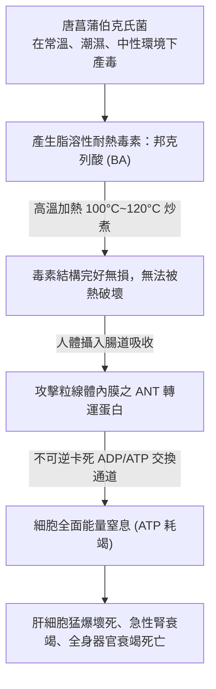

# 致命的廚房隱形殺手：邦克列酸（Bongkrekic Acid）的中毒機制、高危險食材與預防守則 (Bongkrekic Acid & Food Safety)

> 💡 **核心速覽**：邦克列酸被稱為廚房最可怕的「隱形化學炸彈」——它無色無味、耐受 120°C 高溫長達 1 小時烹煮依然不滅！它能直接掐死細胞發電廠「粒線體」，阻斷全身體內能量 ATP 的輸送，導致猛爆性肝腎衰竭，致死率高達 40% 以上。

---

## 1. 案例聚焦：2024 年台灣「寶林茶室」食安風暴

2024 年 3 月，台北信義區寶林茶室爆發嚴重食物中毒事件，累計造成 **34 例通報、6 人不幸身亡**，引起全台對米麵發酵製品的恐慌[^1]。

起初各界懷疑是農藥、重金屬下毒或常見的仙人掌桿菌（嘔吐毒素），但在衛生福利部、法醫研究所與台大醫院通力檢驗下，最終在死傷者血液及廚師手部檢體中檢出致命毒素——**邦克列酸 (Bongkrekic acid, BA)**（舊譯：米酵菌酸）[^1]。

---

## 2. 微觀分子科學：為什麼邦克列酸如此致命？

邦克列酸是由特定細菌——**唐菖蒲伯克氏菌椰毒病原型 (*Burkholderia gladioli* pv. *cocovenenans*)** 代謝產生的多烯三羧酸型毒素[^1]：

### (1) 粒線體的「斷電開關」
- 人體所有細胞生存都需要能量貨幣——**三磷酸腺苷 (ATP)**。ATP 主要在粒線體基質內透過氧化磷酸化反應產生，隨後必須經由粒線體內膜上的**腺苷酸轉運蛋白 (Adenine Nucleotide Translocase, ANT / AAC)** 運送至細胞質，供細胞各項生理功能運作。
- 邦克列酸具有極強的親脂性，能高度專一且**不可逆地鎖定 ANT 轉運蛋白的結合位點**，徹底卡死 ADP 與 ATP 的進出交換。
- 結果：粒線體內的 ATP 無法輸出，細胞質內的能量在短短數十分鐘內歸零，細胞直接走向壞死，尤其是代謝最耗能的器官——**肝臟、腎臟與大腦**會瞬間崩潰[^1]。

### (2) 恐怖的物理特性：耐酸、耐熱、無味
- **超高耐熱性**：一般細菌（如大腸桿菌、沙門氏菌）加熱至 75°C 數十秒即死亡；仙人掌桿菌耐熱毒素約 100°C 煮 30 分鐘可減弱。但邦克列酸在 **100°C 滾水煮沸 1 小時、甚至 121°C 高壓滅菌下，毒素結構依舊完整無損**！下鍋熱炒、油炸完全無法解毒。
- **無感官警訊**：遭受污染的粄條、河粉或木耳，往往**外觀沒有發霉發臭，吃起來沒有酸味或異味**，消費者在不知不覺中吞入致死劑量（人體致死劑量推估僅需 **1 至 3 毫克**）[^1]。

---

## 3. 產毒條件與高風險食材雷區

唐菖蒲伯克氏菌椰毒病原型並不是在所有食物上都能生長產毒，它需要極為嚴苛且特定的環境組合：

| 環境因子 | 產毒最適條件 | 抑制產毒臨界條件（廚房控制點） |
| :--- | :--- | :--- |
| **溫度** | **22°C 至 30°C（台灣春夏季室溫）** | **低於 10°C（冷藏）** 或高於 40°C 停止產毒[^1]。 |
| **酸鹼度 (pH)** | **中性至微鹼性 (pH 6.5 ~ 8.0)** | **pH < 4.5（酸性環境）** 菌株完全無法產毒！ |
| **脂肪酸受質** | 富含油酸 (Oleic acid) 與甘油酯之環境 | 缺乏適當脂肪酸受質時產毒量極低。 |

### 🚨 廚房三大高危險食材：
1. **玉米、小麥發酵澱粉製品**：傳統印尼發酵玉米餅 (Tempe bongkrek)、自製酸湯子、變質玉米麵。
2. **潮濕非乾燥米麵製品**：未妥善冷藏的生鮮粄條、河粉、米線、年糕（尤其是製造過程中添加油脂防止沾黏，又在常溫下運送存放者）。
3. **長時間泡發的黑木耳、銀耳**：木耳表面若附著該菌，在室溫水盆中浸泡超過 24 小時，極易成為產毒溫床。

---

## 4. 家庭自煮與餐飲外食防毒 SOP

面對無解藥、無法以高溫消滅的邦克列酸，唯一的防守手段是**「絕對阻斷產毒條件」**：

1. **生鮮米麵冷藏斷鏈零容忍**：
   - 購買生鮮粄條、河粉、生水餃皮、濕麵條，回家應**立即放入 7°C 以下冷藏室**，若 2 天內未食用完畢應直接**冷凍保存**。
   - 絕不可將受潮米麵製品置於廚房流理台、瓦斯爐旁常溫過夜。
2. **木耳泡發「冷藏泡、短時泡」原則**：
   - 乾木耳泡發時間以 **1 至 2 小時** 為宜，最長不宜超過 4 小時。
   - 若需長時間浸泡，務必**連同保鮮盒放入冰箱冷藏室**浸泡；泡發後若摸起來發黏、有軟爛感，切勿捨不得，應立即全數丟棄。
3. **酸化防護（酸性保鮮）**：
   - 涼拌木耳或發酵米麵調味時，適度加入白醋、檸檬汁（使環境 pH 值降至 4.5 以下），能從生化途徑強效抑制唐菖蒲伯克氏菌的活性。

---

## 5. 相關概念與延伸閱讀
- 食品防護與四大支柱：`[食品防護與現代食安觀](food-protection-and-safety-paradigm.md)`
- 添加物防腐與亞硝酸鹽角色：`[潔淨標示（Clean Label）與「無添加」的科學真相](clean-label-science.md)`
- 菇菌生化與活性成分：`[食藥用菇菌的科學解析：多醣體、三萜類與鮮味協同效應](../ingredients/edible-medicinal-mushrooms-and-umami.md)`

---

## 6. 參考資料與延伸閱讀
1. 謝松源. 《生物資源庫與食藥用菇類產品：細菌毒素、大流行病與邦克列酸中毒案》. 國立清華大學生命科學暨醫學院 / 財團法人食品工業發展研究所生物資源保存及研究中心 (BCRC). 2026-10-15. 投影片 3-6.
2. 衛生福利部疾病管制署 (Taiwan CDC) / 食品藥物管理署 (TFDA). 〈2024年台北市某餐廳邦克列酸食品中毒事件調查報告〉. 2024.
3. Anwar, M., et al. "Bongkrekic Acid: A Review of a Lethal Foodborne Toxin." *Journal of Food Protection*, 2017, 80(10), 1777-1783.
4. Moebius, N., et al. "Biosynthesis of the Respiratory Toxin Bongkrekic Acid in the Pathogenic Bacterium *Burkholderia gladioli*." *Chemistry & Biology*, 2012, 19(9), 1164-1174.
