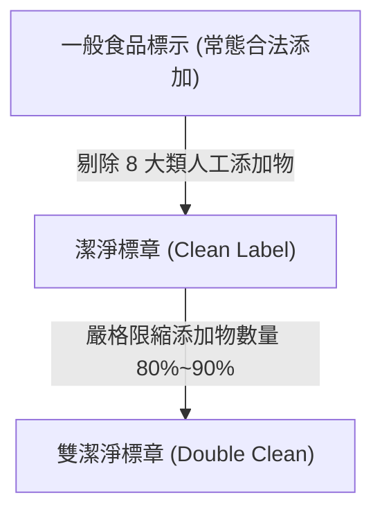

# 潔淨標示（Clean Label）與「無添加」的科學真相 (The Science of Clean Label)

> 💡 **核心速覽**：潔淨標示並非法律上的法定名詞，而是通路商與消費者溝通的「商業與科學語彙」。其核心並非全盤否定添加物，而是透過**原料單純化、最少加工（Minimal processing）與製程優化**，用物理或天然機制取代不必要的人工化學合成物質。

---

## 1. 什麼是「潔淨標示 (Clean Label)」？

走在超市，越來越多食品包裝貼上「100% 無人工添加」、「Clean Label 潔淨標章」或「雙潔淨認證」。這個風潮是怎麼來的？

### (1) 起源與歐盟 E-Number 體系
- **起源**：潔淨標示概念源自歐盟，最早由零售通路商（如英國 Marks & Spencer 等）發起，回應消費者對落落長化學成分表的焦慮與對天然食物的渴望[^1]。
- **歐盟 E-Number（E-編碼）**：歐盟為管理合法食品添加物，建立了一套國際編碼（如 E300 為維生素 C、E250 為亞硝酸鈉、E621 為味精 L-麩酸鈉）。最初是為了標示標準化，但隨後消費者發現「成分表上的 E 編碼越多，代表加工越繁複」，促使產業界開始研發「無 E 編碼」或「極少 E 編碼」的配方[^1]。

### (2) 潔淨標示四大消費者訴求
1. **無／少人工化學添加物**：剔除人工色素、合成香料、防腐劑等。
2. **成分單純易懂**：原料名稱最好是廚房或菜市場常見的名詞（如「麵粉、水、酵母、奶油」）。
3. **資訊公開透明**：清楚揭露產地、非基改與永續原料。
4. **最少加工製程 (Minimal Processing)**：保留食物原始質地與營養。

---

## 2. 台灣的「潔淨標章」評鑑標準

在台灣，由產學研（如食品工業發展研究所等）輔導並推行第三方驗證的 Clean Label 標章主要分為兩級[^1]：

| 標章等級 | 核心規範與剔除原則 | 允許添加物範圍 |
| :--- | :--- | :--- |
| **潔淨標章 (Clean Label)** | 1. 不添加 **8 大類人造添加物**：人工香料、人工色素、人工甜味劑、防腐劑、漂白劑、保色劑、結著劑、含鋁膨脹劑。 2. 原料非基因改造。 3. 農藥殘留符合國家法規標準。 | 仍可使用衛福部正面表列的其他合法食品添加物（如天然抗氧化劑、必要膨脹劑）。 |
| **雙潔淨標章 (Double Clean)** | 符合潔淨標章全部規定，且**大幅限縮**可用添加物範圍。 | 僅限使用衛福部許可的 800 多種添加物中，嚴選之少數（約 10%）**天然來源或加工工藝絕對必要者**（如食鹽、小蘇打、釀造醋等）。 |

---

## 3. 科學機制：如何不用添加物做出好質地？

食品添加物在歷史上並非「罪惡」，它扮演著保水、抑菌、乳化、防氧化的物理化學角色。要拿掉添加物，食品科學家必須透過**「物理機械力」**或**「天然替代素材」**完成技術升級：

### 案例 1：無人工磷酸鹽添加貢丸（食品所研發）
- **傳統作用**：傳統貢丸加入多磷酸鹽 (Polyphosphates)，是為了螯合金屬離子、拉高肉泥的 pH 值與離子強度，使肌肉中的**肌原纖維蛋白 (Myofibrillar protein)** 充分鹽溶溶出，形成強固的三維凝膠網絡，鎖住肉汁並產生彈牙脆度。
- **無添加科學解方**：利用冷藏溫控、精確比例的食鹽與重力拍打剪切力，在高剪切機械乳化中自然誘導肌肉蛋白溶出並交聯成膠，成功開發出台灣第一支**無人工磷酸鹽添加貢丸**[^1]。

### 案例 2：機械超音波減糖（以色列 Torr Foodtech）
- **傳統問題**：堅果能量棒（Granola bars）通常需要大量的玉米糖漿或高果糖漿充當「黏著劑」，將堅果與穀物黏合在一起。
- **物理突破**：利用精密的**機械壓縮力結合超音波振動**，破壞部分穀物表層澱粉細胞壁並誘導分子間瞬時熔融結合，不依賴黏稠糖漿即可固定成形，大幅降低產品糖分[^1]。

### 案例 3：天然改質麥麩替代麵糰改良劑（緣麥鄉雙潔淨烘焙）
- **傳統問題**：高纖全麥麵包因富含粗纖維，會割斷麵筋 (Gluten network)，導致麵包乾硬塌陷，傳統製程需添加化學乳化劑（如單雙甘油酯 DATEM）與修飾澱粉。
- **生物科技解方**：利用益生菌菌酛進行**生物發酵改質麥麩**，降解不可溶粗纖維並釋放天然保水多醣，使全麥麵包在無改良劑下仍具柔軟保水度，獲頒雙潔淨認證[^1]。

---

## 4. 生活迷思破解：無添加一定等於更安全嗎？

大眾往往落入「天然必定健康，化學合成必定有毒」的**自然謬誤 (Appeal to nature)**：

| 評估面向 | 潔淨少添加食品 | 傳統適度添加食品 | 科學真相與客觀分析 |
| :--- | :--- | :--- | :--- |
| **微生物腐敗風險** | **較高**（未添加防腐劑或山梨酸鉀） | **極低且穩定**（抑制黴菌與細菌繁殖） | 不含防腐劑的食品若包裝破損或保存不當（放在常溫危險溫度帶），致病菌繁殖速度遠比傳統食品快，**食品中毒風險反而更高**。 |
| **致命肉毒桿菌防禦** | 若香腸完全不加亞硝酸鹽，風險劇增 | 加入微量亞硝酸鹽 (E250) | 亞硝酸鹽的主要科學目的是**強效抑制肉毒桿菌 (Clostridium botulinum) 芽孢生長與產毒**。肉毒桿菌毒素是人類已知最強神經毒素之一，致死率極高。微量殘留合法添加遠比肉毒毒素中毒安全。 |
| **保存期限與剩食** | 保存期短，易氧化酸敗 | 保存期長，利於物流運送 | 為了維持潔淨標示，冷鏈物流必須極度嚴苛，否則更容易造成糧食浪費與酸敗。 |

> ⚠️ **結論**：潔淨標示是優化食品質地與少用冗餘添加物的進步工藝，但**不代表添加物本身是毒藥**。消費時應理性看清保存期限與溫控指示，切勿因「無防腐劑」而疏忽冷藏保存。

---

## 5. 家庭自煮者的「潔淨料理」科學技巧

在自家廚房，自煮者可靈活運用天然食材中的功能性分子，取代人工調味劑：
1. **天然乳化劑**：自製沙拉醬或醬汁時，加入新鮮**蛋黃**（富含卵磷脂 Lecithin）或**黃芥末醬**（富含天然黏質多醣），即可將油水完美乳化，不需市售化學乳化增稠劑。
2. **天然嫩肉酵素**：醃漬堅硬牛肉時，加入少許新鮮**鳳梨泥（鳳梨蛋白酶 Bromelain）**或**奇異果泥（奇異果酵素 Actinidin）**靜置 15~20 分鐘，能溫和分解肌肉結締組織膠原蛋白，達到軟嫩口感。
3. **天然抗氧化防褐變**：切開的蘋果或馬鈴薯，浸泡於含微量**檸檬汁**（天然抗壞血酸 / 維生素 C）的水中，可還原多酚氧化酶產生的醌類中間體，防止梅納或酵素性褐變。

---

## 6. 相關概念與延伸閱讀
- 食品安全體系：`[食品防護與現代食安觀](food-protection-and-safety-paradigm.md)`
- 法規分類界定：`[食品、健康食品與特殊營養食品的分級界定](food-classifications-and-health-food.md)`
- 新穎食材科學：`[替代性蛋白質與植物肉的科學解析](../ingredients/alternative-proteins-and-plant-meat.md)`

---

## 7. 參考資料與延伸閱讀
1. 簡相堂. 《食品產業現況與發展趨勢：潔淨標示與產業應用》. 國立清華大學 / 財團法人食品工業發展研究所. 2026-09-17. 投影片 25-28, 83.
2. 財團法人食品工業發展研究所 (FIRDI). 〈台灣食品潔淨標章評鑑驗證規範〉. 2024.
3. European Food Safety Authority (EFSA). "Scientific Opinion on the Re-evaluation of Food Additives." *EFSA Journal*, 2020.
4. Asioli, D., et al. "Making Sense of the 'Clean Label' Trends: A Review of Consumer Food Choice Behavior and Industry Implications." *Food Research International*, 2017, 99, 58-71.
