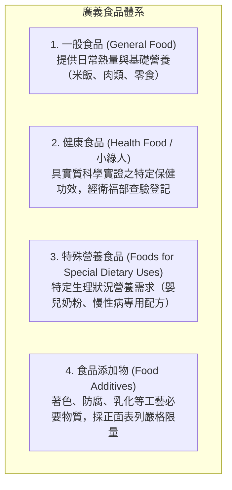

# 保健食品不是藥！食品、健康食品與特殊營養食品的科學與法定界定 (Food Classifications & Regulations)

> 💡 **核心速覽**：在台灣的法律中，並沒有「保健食品」這個法定名詞！只有經過嚴格人體試驗或動物實驗、取得衛福部審查核發「小綠人標章」的，才在法律上具備稱作「健康食品」的資格，且**兩者皆絕對不是藥品，不得宣稱治療疾病**。

---

## 1. 生活迷思：市面上熱銷的「保健食品」都有神奇功效嗎？

走進藥妝店或瀏覽電商，充斥著「膠原蛋白凍」、「薑黃濃縮膠囊」、「蔓越莓萃取錠」等琳瑯滿目的商品，外包裝往往寫著「維持青春美麗、強身健體」。許多民眾常有以下迷思：

- **迷思一**：「只要標示『保健食品』，就代表功效通過政府檢驗？」
  - ❌ **真相**：坊間通稱的「保健食品」，在法律上其實**只是一般食品**！製造商只要符合基本衛生安全規定即可販售，政府並未審查其特定生理「功效」，亦不得宣稱任何療效或生理調節效果。
- **迷思二**：「健康食品既然有小綠人標章，生病時是不是可以多吃來代替吃藥？」
  - ❌ **真相**：健康食品本質仍為「食品」，作用是提供特定保健功效（如輔助調節血脂、延緩衰老），並非以治療、減輕疾病為目的。生病應循正規醫療，盲目過量食用保健營養品反而可能加重肝腎代謝負擔。

---

## 2. 四大法定層級架構拆解

依據台灣《食品安全衛生管理法》與《健康食品管理法》，各類進入嘴裡的物質具有嚴格的法律階層區分[^1]：

### (1) 一般食品 (General Food)
- **法定定義**：指供人飲食或咀嚼之產品及其原料（食安法第 3 條）[^2]。
- **特性**：提供人體生存所需的巨量與微量營養素。坊間無小綠人標章的膠囊錠狀「保健食品/膳食補充劑 (Dietary Supplements)」，法律地位等同於一包洋芋片或一顆蘋果，**嚴禁標示或宣稱醫療效能，違者重罰**。

### (2) 健康食品 (Health Food)
- **法定定義**：具有實質科學證據之「保健功效」，並經中央主管機關（衛福部 TFDA）查驗登記審查合格，發給許可證之食品（健康食品管理法第 2 條）[^3]。
- **識別標誌**：包裝印有標準橢圓形「小綠人」標章，並註明許可證字號（如：`衛部健食字第 A00000 號` 或 `衛部健食規字第 000000 號`）。
- **審查標準**：
  - **第一軌（個案審查）**：業者需提交安全性試驗、毒理試驗及功效性試驗（細胞/動物/人體臨床試驗）報告。
  - **第二軌（規格標準審查）**：產品成分已獲世界公認具有科學功效者（目前僅開放「魚油」與「紅麴」兩項），且成分符合法定規格。
- **法定 13 項保健功效範圍**：
  骨質保健、免疫調節、胃腸功能改善、調節血脂、抗疲勞、輔助調節血壓、延緩衰老、不易形成體脂肪、護肝、輔助調節血糖、牙齒保健、輔助調整過敏體質、促進鐵吸收[^3]。

### (3) 特殊營養食品 (Foods for Special Dietary Uses)
- **法定定義**：指因應特殊生理狀態或疾病需求調製之食品，包含：
  1. 嬰兒配方食品與較大嬰兒配方輔助食品。
  2. 特定疾病配方食品（如洗腎病患高蛋白配方、糖尿病低 GI 營養配方、癌症化療高熱量營養品）[^2]。
- **管理要求**：配方營養比例需經嚴格臨床醫學審查，外包裝必須明確標示「請在醫師、營養師指導下使用」。

### (4) 食品添加物 (Food Additives)
- **法定定義**：為著色、調味、防腐、漂白、乳化、增加稠度、強化營養、防止氧化等目的，加入或接觸於食品之物質（食安法第 3 條）[^2]。
- **管理規範**：台灣採**「正面表列 (Positive List)」**管理，未列於規範中的化學合成物質一律不得使用；且每種添加物均明訂使用範圍（可用於哪些食品）與限量標準（ADI 每日容許攝取量反推）。

---

## 3. 多方觀點與選購指南：消費者如何看懂標示？

市售營養補充品琳瑯滿目，各國管理制度與消費觀點之比較：

| 評估面向 | 台灣健康食品制度 (TFDA) | 美國膳食補充劑制度 (US FDA DSHEA) | 一般無標章市售保健品 |
| :--- | :--- | :--- | :--- |
| **上市審查門檻** | **事前實質審查**：需繳交完整實驗報告取得小綠人執照方可宣稱功效 | **事後追蹤審查**：上市前不需 FDA 審查有效性，僅要求安全無害 | **無功效審查**：僅依一般食品法規進行衛生安全管理 |
| **宣稱用語限制** | 僅能嚴格使用核准之特定字句（如「有助於降低血液中總膽固醇」） | 允許結構/功能宣稱 (Structure/Function Claims)，但需附免責聲明 | 僅能描述基礎營養素生理功能（如「維生素 C 具抗氧化作用」） |
| **消費者認知與成本** | 審查嚴格、研發成本高，終端售價偏高，但功效證據相對可信 | 種類多元創新、進入門檻低，需消費者自行辨識品牌商譽 | 行銷話術易誇大，若盲目跟風容易花冤枉錢 |

### 💡 家庭自保 4 步驟 SOP：
1. **先查證號**：若宣稱特定生理保健功效，先翻到背面找是否有小綠人標章及「衛部健食字號」，可至 TFDA 食品藥物消費者專區網站查詢真偽。
2. **看清警語與建議量**：健康食品外包裝必有注意事項（如「本產品非藥品，多食無益」、「服用抗凝血劑者不宜食用」），務必依建議量食用。
3. **區分單方與複方劑量**：注意有效成分（如葉黃素、原花青素）的實際純度與毫克數，而非只看膠囊總重量。
4. **飲食優先原則**：天然完整食物（Whole foods）所含之植化素、膳食纖維與微量元素具備複雜的協同生物利用率，營養補充品僅供飲食攝取不足時輔助，無法取代均衡膳食。

---

## 4. 相關概念與延伸閱讀
- 食品安全理念：`[食品防護與現代食安觀](food-protection-and-safety-paradigm.md)`
- 添加物與少加工趨勢：`[潔淨標示（Clean Label）與「無添加」的科學真相](clean-label-science.md)`
- 特殊機能食材：`[替代性蛋白質與植物肉的科學解析](../ingredients/alternative-proteins-and-plant-meat.md)`

---

## 5. 參考資料與延伸閱讀
1. 廖啓成. 《食品產業與生物技術 課程導引》. 國立清華大學 / 財團法人食品工業發展研究所. 2026. 投影片 95（作業題二之法規標準分析）.
2. 中華民國衛生福利部. 《食品安全衛生管理法》. 最新修正版.
3. 中華民國衛生福利部. 《健康食品管理法》及施行細則. 最新修正版.
4. 董志宏. 《健康食品與保健營養食品》. 國立清華大學專題講義. 2026.
