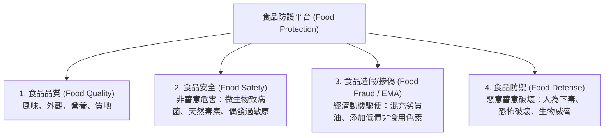

# 食品防護與現代食安觀：從「末端檢驗」到「源頭與防禦管理」 (Food Protection & The Modern Food Safety Paradigm)

> 💡 **核心速覽**：食品安全不是靠實驗室「檢驗」出來的，而是靠「源頭把關」與「製程優化」設計出來的。現代食品科學已將視野從被動的消極檢驗，擴展至全方位的「食品防護 (Food protection)」體系。

---

## 1. 生活迷思：檢驗報告合格，就代表吃得萬無一失嗎？

在日常採買或外食時，許多人常看到商家出示「SGS 檢驗合格」、「通過 380 項農藥殘留檢驗」的報告，便深信該食品「絕對安全無毒」。

然而，在食品科學與品管實務中，有一個至關重要的金句：
> **「食品安全是設計與管理出來的，不是檢驗出來的。」**[^1]

為什麼末端檢驗無法保證 100% 的安全？
1. **抽樣機率限制**：檢驗只能針對批次中的極少數樣品抽檢，若污染呈不均勻分佈（如黃麴毒素常聚集在少數發霉穀粒上），極可能抽不到。
2. **未知危害的檢測盲點**：常規檢驗只能驗「已知且列入清單的物質」。回顧歷史上的重大食安事件（如 2008 年三聚氰胺毒奶粉事件、2011 年塑化劑起雲劑事件、2013 年順丁烯二酸修飾澱粉事件），摻偽物質在事發前均不在法定常規檢驗項目內[^1]。若不從源頭原料供應鏈稽核，再精密的儀器也無法防範蓄意造假。

---

## 2. 微觀與體系科學：食品防護的四大支柱

現代國際食品科學界（包含美國 FDA、歐盟 EFSA 與台灣食品工業發展研究所）已將「食品安全 (Food safety)」的概念提升為涵蓋範圍更廣的 **食品防護 (Food protection)** 矩陣，主要由四大支柱所構築[^1]：

### 四大面向解析：
1. **食品品質 (Food Quality)**：食物的色香味、組織質地與營養保存，通常受酵素活性、脂質氧化與微生物繁殖影響。
2. **食品安全 (Food Safety)**：預防**非蓄意（Unintentional）**的天然或偶發危害，例如：沙門氏菌 (Salmonella)、李斯特菌 (Listeria monocytogenes)、包裝過程金屬雜質或農藥超標。
3. **食品造假／經濟動機摻偽 (Food Fraud / Economically Motivated Adulteration, EMA)**：為了追求不法暴利而刻意進行的偷工減料或違法添加（如用工業染料蘇丹紅提升辣椒粉色澤、橄欖油混摻廉價芥花油）。這類危害往往具隱蔽性，需仰賴原產地溯源同位素分析與供應鏈查核。
4. **食品防禦 (Food Defense)**：防範**蓄意（Intentional）**人為破壞或下毒，強調工廠門禁管制、原料儲槽上鎖與資安防護。

---

## 3. 廚房中的落實：家庭版「食品防護」操作守則

將工業級的食品防護思維降維到家庭廚房，關鍵在於**「阻斷污染途徑」**而非事後補救：

### (1) 嚴格控制「危險溫度帶 (Danger Zone)」
- **5°C 至 60°C** 是絕大多數細菌（如大腸桿菌、金黃色葡萄球菌）快速繁殖的區間。
- 煮熟的食物若未立即食用，應在 2 小時內降溫並冷藏（低於 7°C）；再次加熱時中心溫度須達到 **75°C 以上** 並維持至少 30 秒[^2]。

### (2) 砧板與刀具的生熟分離（避免交叉污染）
- 生肉、海鮮常帶有沙門氏菌或副溶血弧菌 (Vibrio parahaemolyticus)。切勿使用同一塊砧板先切生雞肉再切生菜沙拉。
- 準備至少兩套砧板（建議以顏色區分：紅色處理生肉、綠色處理蔬果與即食品）。

### (3) 洗肉迷思破解
- 在水龍頭下直接沖洗生雞肉，水花噴濺直徑可達 **1 公尺**，會將生肉表面的彎曲桿菌 (Campylobacter) 噴濺到周邊洗好的碗盤或流理台上。
- 正確做法：若需清理，以廚房紙巾輕輕吸乾表面血水，直接下鍋透過高溫加熱殺菌即可。

---

## 4. 實驗條件與多方觀點比對

針對「高風險即食食品的滅菌與品管標準」，食品界與餐飲業在操作策略上的對照：

| 評估維度 | 工業量產（食品工廠） | 現代精緻餐飲 / 低溫烹調 (Sous-vide) | 一般家庭自煮 |
| :--- | :--- | :--- | :--- |
| **核心目標** | 絕對商業無菌 (Commercial Sterility) 或百萬分之一不良率 | 質地嫩度極大化兼顧巴氏殺菌對數下降 | 操作便利、快速熟化與基本衛生 |
| **殺菌條件** | 高壓高溫蒸煮：中心溫度 121°C，維持至少 3 分鐘 (12D 滅菌)[^1] | 55°C ~ 65°C 低溫長時間水浴，配合精確時間曲線達到 5D~6D 殺菌 | 瓦斯爐大火滾煮或中心溫度計實測達 75°C 以上 |
| **品管手段** | 嚴格 HACCP 危害分析重要管制點監控、ATP 生物冷光表面塗抹測試 | 核心探針式溫度計即時監控、水浴循環溫控機 | 觀察肉汁清澈度、骨肉分離或使用一般家用食品溫度計 |
| **潛在風險點** | 原料批次摻偽 (Food Fraud)、管線盲端死角微生物沉積 | 密閉缺氧真空袋中肉毒桿菌 (Clostridium botulinum) 產毒風險 | 冰箱冷藏過載（溫度上升高於 7°C）、生熟交叉污染 |

---

## 5. 相關概念與延伸閱讀
- 食品法定定義與標示：`[食品、健康食品與特殊營養食品的分級界定](food-classifications-and-health-food.md)`
- 添加物與無添加科學：`[潔淨標示（Clean Label）與「無添加」的科學真相](clean-label-science.md)`
- 烹調滅菌工藝：`[舒肥低溫慢煮的熱穿透與安全時間控制](../techniques/sous-vide-safety.md)`（待建立）

---

## 6. 參考資料與延伸閱讀
1. 廖啓成. 《食品產業與生物技術 課程導引：食品、食品安全、食品生技》. 國立清華大學生物科技研究所 / 財團法人食品工業發展研究所. 2026-09-10. 投影片 24-26, 94.
2. 衛生福利部食品藥物管理署 (TFDA). 〈食品中毒常見原因與預防原則：五要原則〉. 2023.
3. Spink, J., & Moyer, D. C. "Defining the Public Health Threat of Food Fraud." *Journal of Food Science*, 2011, 76(9), R157-R163.
4. Food and Agriculture Organization (FAO) / World Health Organization (WHO). *Food Safety Risk Analysis: A Guide for National Food Safety Authorities*. 2006.
