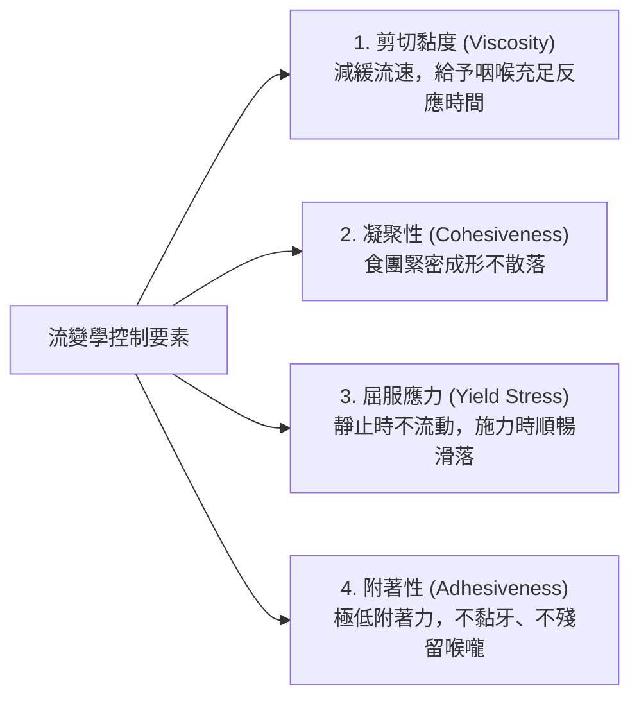

# 食物質地設計與高齡友善飲食：從 IDDSI 國際吞嚥分級到酵素嫩化與防嗆咳增稠科學 (Food Texture Modification & Dysphagia Diet)

> 💡 **核心速覽**：照顧咀嚼吞嚥不便的長者，絕對不是把所有飯菜倒進果汁機打成一碗灰褐色的泥狀物！現代食品科技透過**「質地重構 (Texture re-engineering)」**與**「親水膠體黏度調控」**，能做出「外觀維持原形、用舌頭輕輕一頂就化開、且滑順不嗆咳」的尊嚴美食。

---

## 1. 廚房與生活痛點：為什麼喝水比吃肉更容易嗆到？

許多人以為長輩牙口不好，只要把食物切碎、煮爛即可；或者以為「水最稀薄，最好吞」。但在高齡醫學與口腔生理學中，這是一個極度危險的誤區：

1. **吞嚥反射延遲 (Delayed swallow reflex)**：水或稀薄流質的流速極快。健康的喉部會在瞬間上抬並關閉會厭軟骨 (Epiglottis)，阻斷呼吸道；但高齡長者神經傳導遲緩，當水流快速衝向咽喉時，會厭軟骨來不及閉合，液體便直接流入氣管，引發劇烈嗆咳，甚至導致長者死亡率極高的**吸入性肺炎 (Aspiration pneumonia)**[^1]。
2. **食團凝聚力不足 (Poor bolus formation)**：切得細碎乾硬的肉末或鬆散的炒飯，在口腔中無法被唾液聚集成一整顆滑潤的「食團 (Bolus)」，散落的顆粒容易卡在喉頭梨狀窩，隨吸氣嗆入氣管[^1]。

---

## 2. 微觀科學機制：食物質地的流變學四大要素

在食品物理學中，調控高齡友善食品的質地必須精準平衡以下流變學特性[^1]：



1. **剪切黏度 (Shear viscosity)**：在適度剪切速率下，液體需具備「剪切稀化 (Shear-thinning)」特性——吞嚥前在湯匙上維持穩定濃稠度不潑濺，通過咽喉受肌群擠壓時黏度瞬時下降，順暢滑入食道。
2. **抗離水性 (Anti-syneresis)**：傳統以太白粉或玉米澱粉勾芡的液體，靜置降溫或接觸唾液中的**澱粉酶 ($\alpha$-Amylase)** 後，多醣鏈老化回生脫水（離水現象），原本濃稠的芡汁會瞬時化成水，反而引發長者嗆咳。現代質地設計需改用耐澱粉酶水解的**黃原膠 (Xanthan gum)** 或修飾膠體。
3. **低附著性 (Low adhesiveness)**：麻糬、年糕、白吐司黏性過強，黏在咽喉壁極難咳出，是高齡窒息頭號殺手；理想的高齡質地要求高凝集、極低附著。

---

## 3. 國際標準與台灣標章分級

為建立醫療、長照與家庭溝通的共通語言，國際與台灣建立了客觀的質地分級標準：

### (1) IDDSI 國際吞嚥障礙飲食架構 (0~7 級)
由全球吞嚥專家制定的雙金字塔框架，用簡單的「4 號叉子測試 (Fork test)」與「10ml 針筒流速測試 (Syringe test)」客觀量化[^1]：

```text
【飲品/流質】              【食品/固質】
Level 0: 薄流質 (如水)       Level 7: 正常常態食物
Level 1: 極微稠            Level 6: 軟質及一口量 (軟度如香蕉，可用叉邊切斷)
Level 2: 低度稠 (如花蜜)     Level 5: 細碎及濕軟 (食團濕潤，顆粒 <4mm)
Level 3: 中度稠 (如蜂蜜) ─── Level 3: 流質狀 (可用湯匙舀，叉齒間微滲)
Level 4: 高度稠 (如布丁) ─── Level 4: 泥狀 (表面光滑不滴落，叉背下壓不起痕)
```

### (2) 台灣農業部 / 食品所 Eatender 銀髮友善食品標章
台灣食品所建立的質地規格，依牙口能力分為四大等級[^1]：
1. **容易咬 (Easy to Chew)**：牙齒健全或輕度缺牙者適用，食材經加熱軟化。
2. **牙齦咀嚼 (Chewable with Gums)**：食材硬度低於 $5 \times 10^4 \ N/m^2$，可用無牙牙齦壓碎（如煮爛的馬鈴薯、滑嫩蒸蛋）。
3. **舌頭壓碎 (Crushable with Tongue)**：硬度極低，舌頭往上顎輕頂即可化開（如嫩豆腐、凝膠果凍）。
4. **無須咀嚼 (No Chewing Needed)**：完全均質化、具適度黏度之稠流質或細泥狀。

---

## 4. 家庭廚房實作技巧：如何用科學手法軟化食材？

### (1) 酵素滲透嫩化肉排（維持原形，入口即化）
- **傳統失誤**：燉煮數小時的大塊牛肉，雖然結締組織軟化，但肌原纖維蛋白質嚴重熱變性緊縮，肉質乾柴塞牙。
- **科學解法（天然蛋白酶真空滲透）**：
  1. 取新鮮**鳳梨泥（含鳳梨蛋白酶 Bromelain）**、**奇異果泥（含 Actinidin）**或**白蘿蔔泥**，以冷水稀釋取澄清汁液。
  2. 肉排表面以叉子密刺細孔，浸入果汁中冷藏醃漬 30~60 分鐘（若有家用真空機密封，減壓環境能加速酵素快速滲透進肌肉深層）。
  3. 蛋白酶會特異性剪切肌動球蛋白與肌束膜，烹調後肉排依然完整成型，但筷子一夾即斷、舌頂即碎[^1]。

### (2) 製作防離水、防嗆咳高湯芡汁
- **配方要訣**：避免單用太白粉勾芡。改用**黃原膠 (Xanthan gum)**（添加量約 0.3%~0.5%）或市售商業食物增稠劑（主要成分為黃原膠搭配刺槐豆膠）。
- **操作手法**：黃原膠不需加熱即可在冷水或溫熱高湯中快速水合形成網絡，耐唾液澱粉酶分解，即使放置 2 小時依然均勻滑潤，不會產生水液分離。

### (3) 家用簡易叉子壓痕測試 SOP (Fork Drip & Pressure Test)
- **測試軟度**：用金屬叉叉背用力按壓食材，食材被輕易壓碎且指甲未發白變色，即達「舌頭壓碎級」。
- **測試黏性與離水**：舀起一匙泥狀食物倒置，若能完整滑落且湯匙上幾乎無殘留黏附，亦無水滴滲出，即為最安全的高齡吞嚥質地。

---

## 5. 相關概念與延伸閱讀
- 食品安全法規：`[食品防護與現代食安觀](../myths-safety/food-protection-and-safety-paradigm.md)`
- 添加物與無添加科學：`[潔淨標示（Clean Label）與「無添加」的科學真相](../myths-safety/clean-label-science.md)`
- 機能性食材與微膠囊：`[機能性食品成分與生化機制](../ingredients/functional-food-ingredients.md)`
- 蛋白質變性工藝：`[舒肥低溫烹調的膠原蛋白水解機制](sous-vide-collagen.md)`（待建立）

---

## 6. 參考資料與延伸閱讀
1. 王怡晶. 《高齡科技與 Eatender 銀髮友善食品：老化生理、質地分級與技術研發》. 國立清華大學 / 財團法人食品工業發展研究所. 2026-10-08. 投影片 2-15, 45-72.
2. Cichero, J. A., et al. "Development of International Terminology and Definitions for Texture-Modified Foods and Thickened Fluids Used in Dysphagia Management: The IDDSI Framework." *Dysphagia*, 2017, 32(2), 293-314.
3. 農業部 / 財團法人食品工業發展研究所. 〈Eatender 銀髮友善食品質地規格與標章評選作業要點〉. 2024.
4. Chen, J., & Rosenthal, A. *Food Oral Processing: Fundamentals of Eating and Sensory Perception*. Wiley-Blackwell, 2015.
