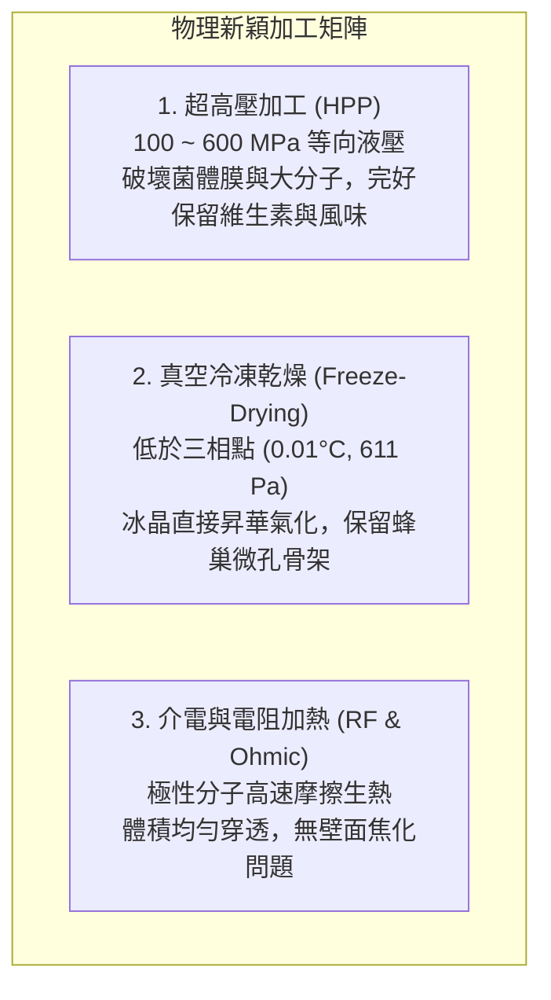

# 新穎非熱加工與物理保鮮科技：超高壓（HPP）、射頻加熱（RF）與冷凍乾燥的微觀物理學 (Novel Food Processing Technologies)

> 💡 **核心速覽**：傳統殺菌一定要用大火滾煮嗎？不！現代食品物理學開創了**「非熱加工 (Non-thermal processing)」**——利用相當於 6000 個大氣壓的「超高壓 (HPP)」直接把細菌細胞壁壓垮，卻完全不破壞嬌貴的維生素 C 與花青素；或是利用水在真空下的「三相點」讓冰晶直接昇華，做出酥脆多孔的冷凍乾燥美食。

---

## 1. 廚房與工業的技術演進：為什麼熱加工會讓食物「走味」？

千百年來，人類保存食物最主要的手段是「熱」——高溫巴氏殺菌、蒸煮、油炸、烘烤。
然而，高溫是把雙刃劍：
- 在殺滅微生物的同時，熱能也會無差別打斷弱化學鍵，使熱敏性維生素（如維生素 C、B 群）嚴重熱裂解、引發非預期的梅納反應導致褐變，並使天然鮮果香氣分子（酯類、萜烯類揮發物）大量逸散蒸發，形成令人不悅的「蒸煮味 (Cooked flavor)」。

為了解決「既要徹底殺菌安全，又要保留宛如現摘現做之鮮活風味」的矛盾，食品科學家開闢了以**壓力、真空相變與高頻電磁場**為核心的新穎物理加工技術[^1]。

---

## 2. 核心新穎加工技術之物理原理

### (1) 超高壓加工處理 (High Pressure Processing, HPP)
- **物理參數**：**100 至 600 MPa**（相當於 1,000 至 6,000 個大氣壓；相比之下，世界最深的馬里亞納海溝底部水壓約為 110 MPa）[^1]。
- **物理三大定律應用**：
  1. **帕斯卡原理 (Pascal's Principle)**：液體壓力以音速在密封腔體中**瞬間、均勻且等向傳遞**，不論包裝形狀與厚薄，內部受壓完全一致，無傳統熱傳導的中心死角問題。
  2. **勒夏特列原理 (Le Chatelier's Principle)**：任何伴隨體積縮小的物理或化學變化，在高壓下均會被強烈促進。微生物細胞膜雙層磷脂質在 400 MPa 以上會被緊密壓縮結晶化，膜蛋白構型破壞，造成細胞內物質外洩、菌體死亡。
  3. **共價鍵完好性 (Covalent bond stability)**：高壓只能破壞非共價鍵（氫鍵、疏水鍵、離子鍵），**無法打斷高能量的共價鍵**。因此，決定營養與鮮果風味的小分子化合物（維生素 C、花青素、揮發性香氣分子）結構完全不受破壞[^1]。
- **商業應用代表**：
  - **冷壓蔬果汁**：在全密封包裝下進行冷水高壓滅菌，未經一滴火煮，冷藏保存期由原本 3 天延長至 30~60 天，且色澤風味宛如現榨。
  - **生蠔/龍蝦低溫脫殼**：高壓使閉殼肌附著蛋白微幅變性脫落，肉質 100% 完整剝離且依然維持生鮮刺身等級口感。

### (2) 冷凍乾燥 (Freeze Drying / Lyophilization)
- **熱力學三相點 (Triple Point of Water)**：水的三相點精確座標為 **溫度 0.01°C、壓力 611.65 Pa (約 0.006 atm)**。在此臨界點以下，液態水無法穩定存在，水只能在「固態冰」與「氣態水蒸氣」之間轉換。
- **昇華乾燥流程**：
  1. **預凍**：食材切片後快速冷凍至 -40°C 以下，內部水分凝結為微小冰晶。
  2. **主乾燥（昇華 Sublimation）**：將腔體抽至高真空（低於 100 Pa），微幅供熱，冰晶不經過液態融化，直接跳級昇華為水蒸氣排出。
- **特徵優勢**：由於冰晶原地昇華，原本冰晶佔據的空間留下緻密的微觀「蜂巢狀多孔骨架」，**食品體積完全不收縮、不塌陷**，咬下去具備獨特的酥脆口感，倒入冷水或牛奶中數秒內即可完全吸水復原[^1]。

### (3) 射頻加熱 (Radio Frequency, RF) 與 歐姆加熱 (Ohmic Heating)
- **射頻加熱（頻率 13.56 / 27.12 MHz）**：利用波長長達數公尺的電磁波，穿透深度遠大於家用微波（2.45 GHz），能穿透厚重大包裝食材。食品中的極性分子（如水）與解離鹽類離子在高頻交變電場中高速擺動碰撞，直接在**分子內部產生體積摩擦熱 (Volumetric heating)**，實現由內而外的極速均勻解凍與乾燥[^1]。
- **電阻加熱（焦耳熱 $Q = I^2 R t$）**：直接將安全交流電通過具導電度的流體食品（如含有顆粒的果醬、咖哩醬），利用食物自身電阻發熱。完全擺脫傳統金屬鍋壁或夾套加熱時「鍋邊已燒焦、鍋心還沒滾」的壁面焦化宿疾[^1]。

---

## 3. 農產全材高值化循環利用 (Food Upcycling)

現代綠色食品科技強調「全果利用 (Whole-crop utilization)」，將過去當作廢棄物的農產格外品或加工殘渣轉化為高附加價值產品[^1]：

| 原料項目 | 傳統農業副產物 | 新穎物理/生技萃取轉型 | 終端高值化產物 |
| :--- | :--- | :--- | :--- |
| **鳳梨** | 鳳梨莖、外皮削切殘渣 | 酵素萃取分離純化、低溫噴霧乾燥 | **醫藥級鳳梨酵素 (Bromelain)**、高纖烘焙機能纖維配料 |
| **仙草** | 傳統需長時間熬煮之乾莖葉 | 桃園農改場超微粉碎技術 (<10 $\mu m$) | **微細化仙草葉粉**，不需久煮即可直接加入烘焙甜點調配 |
| **咖啡** | 每天產生巨量之咖啡渣 | 低溫高壓萃取脂質與多酚，殘渣紡絲結合 | 興采實業專利製程，製成具抗紫外線與除臭機能之 **S.Café® 環保機能服飾** |

---

## 4. 相關概念與延伸閱讀
- 添加物替代工藝：`[潔淨標示（Clean Label）與「無添加」的科學真相](../myths-safety/clean-label-science.md)`
- 細菌與微生物鑑定：`[益生菌的「身分證」：菌株特異性與安全性評估](../ingredients/probiotics-and-strain-specificity.md)`
- 質地改質與嫩化：`[食物質地設計與高齡友善飲食](food-texture-modification-and-iddsi.md)`
- 食安防護體系：`[食品防護與現代食安觀](../myths-safety/food-protection-and-safety-paradigm.md)`

---

## 5. 參考資料與延伸閱讀
1. 張湘文. 《農產原料與新穎科技的應用實務：超高壓HPP、乾燥技術、射頻介電加熱與全材高值化》. 國立清華大學 / 財團法人食品工業發展研究所. 2026-10-29. 投影片 3-13, 39-48, 140-168.
2. Barbosa-Cánovas, G. V., et al. *Novel Food Processing Technologies*. CRC Press, 2004.
3. Raso, J., & Heinz, V. *Pulsed Electric Fields Technology for the Food Industry: Fundamentals and Applications*. Springer, 2006.
4. Singh, R. P., & Heldman, D. R. *Introduction to Food Engineering (5th Edition)*. Academic Press, 2013.
